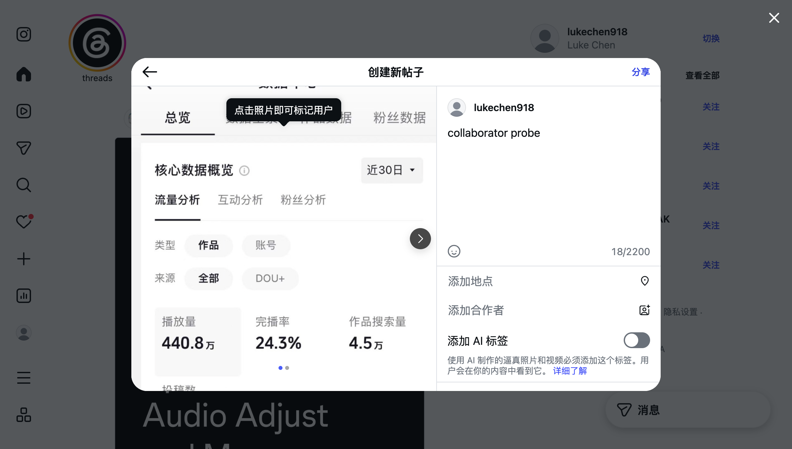
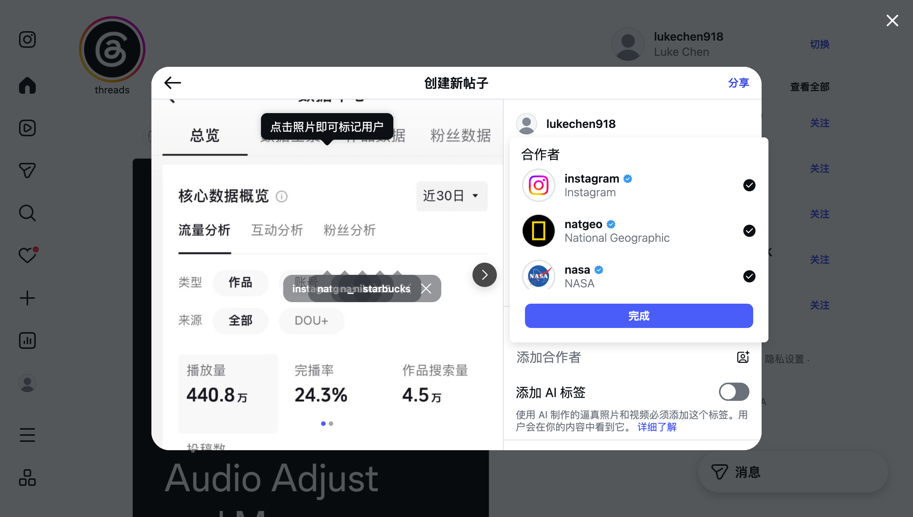
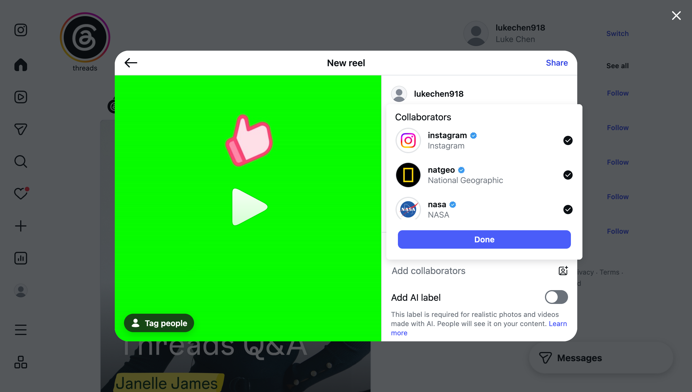
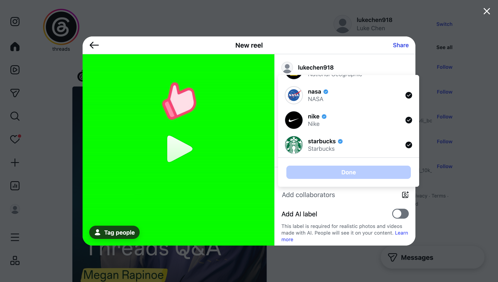

# Instagram Collaborators 实测记录

- 日期：2026-11-24
- 账号：`luke` / `lukechen918`
- Profile：`browser_profiles/chrome/instagram/luke`（本地 Chrome 158.0.8127.37）
- 方法：复用 `InstagramUploader` 走到配文页（`--no-publish` 语义），只操作协作者控件；**全程未点击 Share**。
- 证据目录：`evidence/`（4 张关键截图；完整 HTML/JSON 与一次性脚本已在提取结论后删除）
- 方法说明：探测脚本复用 `InstagramUploader` 的私有流程把页面推进到配文页；脚本与原始 DOM 不进入生产代码，也不保留在仓库。

## 1. 入口

| 界面语言 | 入口 |
|---|---|
| `zh-CN` | `input[name="creation-collaborator-input"]`，`placeholder="添加合作者"` |
| `en` | `input[name="creation-collaborator-input"]`，`placeholder="Add collaborators"` |

- 结构属性优先；同一创建页的地点输入是 `input[name="creation-location-input"]`。
- 图文/轮播与 Reels 两种配文页都有该入口。



## 2. 图文 / 轮播

- 输入/聚焦后同样打开 **Collaborators 面板**：勾选列表 + `Done`（中文「完成」）。
- 与 Reels 的区别：图文/轮播还会把已选账号渲染成**预览图上的标签**（chip）：
  - `span` 文本为 username；
  - 同一容器内有 `role="button"` 的关闭按钮（`svg` 的 `aria-label` 为 `关闭` / `Close`）。
- 图片标签是图文帖**逐个添加后最直接的回读证据**；面板行本身也有 checkbox（与 Reels 相同）。
- 输入 5 人后，输入框 `value` 变为 `5位用户`（中文）/ `5 people`（英文）。
- 第 6 个候选仍可点击，但页面静默忽略；输入框保持 5 人摘要。
- 面板需要点 `Done` 收起；本次探测没有单独点击图文的 Done，但面板与 Reels 是同一组件，Done 行为由 Reels 探测确认。



## 3. Reels

- 输入/聚焦后打开 **Collaborators 面板**：勾选列表 + `Done`。
- 面板行显示 username、显示名、头像与 checkbox（`aria-checked` / `checked`）。
- 点 `Done` 关闭面板，**已选保留**；重新打开面板仍能读到 5 个勾选。
- 5 人后输入框为 `5 people`；第 6 个不加入。
- Reels **没有**图文那种预览图标签；面板关闭后，已选用户名不再出现在创建弹窗的 `innerText` 中。因此 Reels 的逐个回读必须在面板内读 checkbox，不能依赖 Done 后的文本。
- 面板是覆盖在配文页上的浮层；不点 Done 会挡住后续选项与 Share 区域。





## 4. 精确匹配反例

- 请求 `nike` 时，子串匹配会选中 `_nikeza5`（行文本 `_nikeza5 nikeza🎀` 包含 `nike`）。
- 联想行的文本形态是 `username display name`，首个 token 是 username。
- 结论：只能按 username 首 token 精确匹配；显示名不参与匹配，包含/模糊匹配必须禁止。

## 5. 人数上限

- 同一账号、同一天，图文与 Reels 的网页上限均为 **5**。
- Meta Content Publishing API 文档写 **3**；本 CLI 自动化的是网页创建页，因此以网页实测 5 为准。
- 仅验证一个账号、两种帖型；其他账号、地区或灰度可能不同，网页上限存在漂移风险。

## 6. 未覆盖

- 英文界面的**图文** chip 结构（中文图文与英文 Reels 已验；英文图文未复跑）。
- 中文界面的 **Reels** 面板（英文 Reels 已验；中文 Reels 未复跑）。
- 图文面板的 `Done` 没有单独点击；面板与 Reels 是同一组件，Done 行为由 Reels 探测确认。
- 第二账号接受/拒绝邀请后的作品归属；本能力明确不做。
- 与 `user_tags` 同时存在时的 DOM 区分；本 CLI 不设置 user tags。
- 托管模式（MLX / AdsPower / 比特浏览器）下的真实账号验收。
- 5 人上限在其他账号上的稳定性。

## 7. 关键 DOM 片段（从已删除的完整页面提取，省略 hash 类名）

图文图片标签（每个协作者一个）：

```html
<div style="position:absolute; z-index:2; transform:translate3d(...)">
  <div><div><div>
    <span>
      <span>natgeo</span>
      <div>
        <div role="button" tabindex="0">
          <svg aria-label="关闭"><!-- 中文；英文为 Close --></svg>
        </div>
      </div>
    </span>
  </div></div></div>
</div>
```

Reels Collaborators 面板中的一行：

```html
<button>
  <div></div>
  <div>
    <span>natgeo</span>
    <span>National Geographic</span>
  </div>
  <input aria-label="Checkmark filled icon" aria-checked="true"
         type="checkbox" checked>
</button>
```

- 只使用 `input[name="creation-collaborator-input"]`、username 文本、`aria-checked` / `aria-label` 等结构信号；禁止 hash 类名。
- `span` 文本的首个 token 是 username，显示名不参与匹配。

## 8. 安全与清理

- 所有探测均停在 Share 前；浏览器关闭后草稿丢弃，未发出任何邀请。
- 2026-11-24 已清理：删除完整 HTML、原始 `evidence.json`、全部过程截图与一次性探测脚本；仅保留 `evidence/` 下 4 张关键截图。
- 清理前的原始产物只用于本次规格评审，不进入后续提交。
